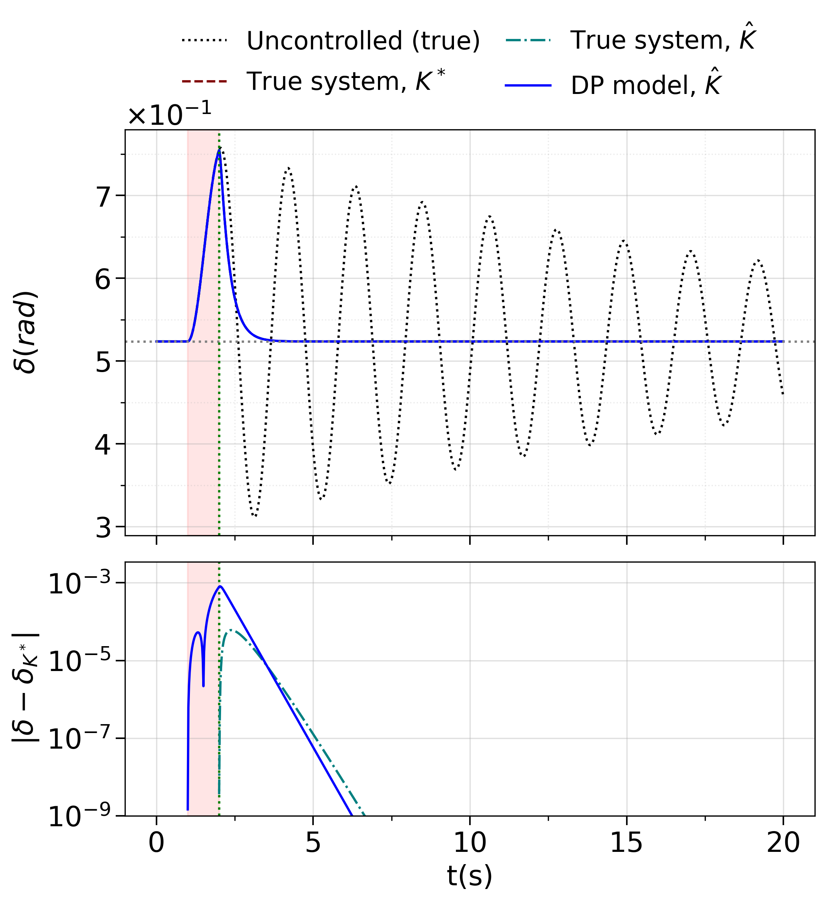
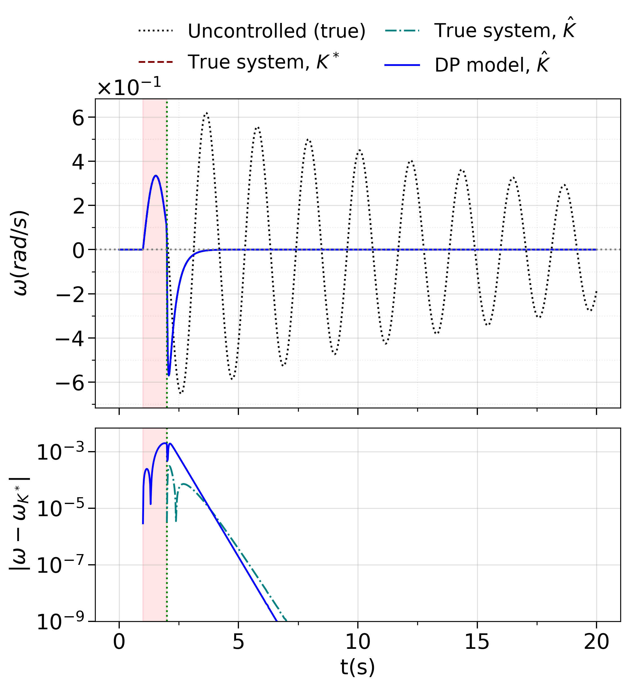

# SMIB case study: article tables and figures

<p align="center">
  
  
</p>

*Fig. 3. Responses of `delta` (left) and `omega` (right) for the DP gain with the largest
`e_c` at `P_m = 0.5`. Lower panels: difference from the true system under `K*`.*

Data, saved results and scripts that regenerate the computed tables and figures of
*Physical Structure and Noisy Initial States in Learned Dynamics for Identification and
LQR Control: An SMIB Case Study* (S. Kang, S. Kim, S. Yun), IEEE Access (submitted).
No retraining is needed. Training code and checkpoints are available from the
corresponding author upon reasonable request.

## Quick start

```bash
pip install -r requirements.txt
python check.py
python make_article.py
```

`check.py` recomputes the gain, cost and response metrics from the stored parameter
estimates and Jacobians, re-simulates the Fig. 3 traces, and compares every regenerated
table and figure byte for byte with `reference/`. It prints PASS on success.
`make_article.py` writes the tables and figures to `out/`.
Verified on AMD Ryzen 7 7800X3D (AVX-512), Ubuntu 24.04 and Python 3.12.3.

## Tables and figures

| Item | File | Input in `results/` |
|---|---|---|
| Table 2 | `table_noise_realizations.tex` | `identification_estimates.csv` |
| Table 3 | `table_baseline_control.tex` | `parameter_control_cases.csv` |
| Table 4 | `table_structure.tex` | `r01_cases.csv` |
| Table 5 | `table_dp_starts.tex` | `r01_cases.csv` |
| Table 6 | `table_low_gain.tex` | `weight_cases.csv` |
| Fig. 3 | `lqr-dp-delta.png`, `lqr-dp-omega.png` | `lqr_dp_traces.npz` |
| Fig. 4 | `structure_protocol.pdf` | `r01_cases.csv` |
| Fig. 5 | `weight_response.pdf` | `weight_cases.csv` |

## Contents

- `data/`: identification data (light plant, `sigma = 0.05`, five noise draws) and NODE/DP
  control training data.
- `results/`: parameter estimates, per-case metrics, learned Jacobians and the Fig. 3 traces.
- `smib.py`: plants, linearization, LQR and simulation. `make_article.py`: generator.
  `check.py`: checks.

## Scope

All data are synthetic. Plants `(M, D, P_max)`: `(0.2, 0.1, 0.5)` (primary) and
`(0.1, 0.01, 1)` (light), with `Q = diag(10, 1)` and `R = 0.1`. At `R >= 1`, `e_c`, the
nonlinear cost gap and the phase-slip labels are stored simulation outputs and are not
recomputed.

## License

MIT
